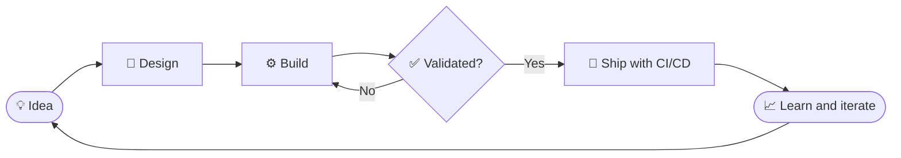

<div align="center">


<a href="https://github.com/amlewi-dev">
  
</a>

<p>
  <a href="https://www.linkedin.com/in/lewis-odero-developer/"></a>
  <a href="mailto:lewisodero27@gmail.com"></a>
  
</p>

</div>

<!-- Psst. If you are reading the raw source, you are my kind of person. Say hi. -->

---

## 💻 `whoami`

```console
lewis@nairobi:~$ whoami
Lewis Odero, software developer

lewis@nairobi:~$ cat mission.txt
Build software African businesses can trust,
starting with the most regulated industries.

lewis@nairobi:~$ ls ~/now
kielelezo/   portfolio/   mobility-app/

lewis@nairobi:~$ echo $STATUS
Shipping in public. One commit at a time.
```

> [!NOTE]
> I'm new here. This account started on **10 November 2026**, and everything on this profile is built in public from day one.

---

## 🎛️ Status board

> [!IMPORTANT]
> **Building:** Kielelezo, a compliance SaaS platform for SACCOs, insurers, banks, hospitals and government agencies across Africa.

> [!TIP]
> **Designing:** my portfolio and services site, with Next.js, Three.js and Motion. Premium, fast, animated but restrained.

> [!WARNING]
> **Exploring:** a Kenya mobility app on Expo and React Native: verified driver hire, tourist drivers, mechanic dispatch and towing.

---

## 🗺️ How I ship



---

## 🧮 My formula

$$
\text{Impact} = \text{Code} \times \text{Consistency}^{\text{Days}}
$$

Footnotes work on GitHub too.[^1]

[^1]: Yes, this profile has math, diagrams, alerts and footnotes. All pure Markdown.

---

## ✅ Roadmap

- [x] Join GitHub
- [x] Ship my first profile README
- [x] Add a contribution snake
- [ ] Launch my portfolio and services site
- [ ] Ship the first public Kielelezo milestone
- [ ] Prototype the Kenya mobility app

---

## 🛠️ Tech stack

<div align="center">


<br/>

<br/><br/>


</div>

---

## 🐍 Contribution snake

<div align="center">

<picture>
  <source media="(prefers-color-scheme: dark)" srcset="https://raw.githubusercontent.com/amlewi-dev/amlewi-dev/output/github-snake-dark.svg" />
  <source media="(prefers-color-scheme: light)" srcset="https://raw.githubusercontent.com/amlewi-dev/amlewi-dev/output/github-snake.svg" />
  
</picture>

</div>

---

## 📊 Stats

<div align="center">


<br/>


</div>

---

## 🤓 Pro tips from my profile

<details>
<summary><b>⌨️ GitHub shortcuts most people don't know</b> (click to open)</summary>
<br/>

| Press | What it does |
| :-: | :-- |
| <kbd>.</kbd> | Opens any repo in a full VS Code editor in your browser |
| <kbd>t</kbd> | Fuzzy file finder inside a repo |
| <kbd>y</kbd> | Turns the URL into a permanent link to that exact commit |
| <kbd>/</kbd> | Jumps to search |
| <kbd>?</kbd> | Shows every shortcut on the current page |

</details>

<details>
<summary><b>🔗 URL tricks</b> (click to open)</summary>
<br/>

- `github.com/amlewi-dev.png` returns my profile picture as an image file
- `github.com/amlewi-dev.keys` lists my public SSH keys
- Add `.patch` or `.diff` to the end of any commit or pull request URL to get it as plain text

</details>

<details>
<summary><b>🥚 Don't open this</b></summary>
<br/>

You opened it. Respect. 😄

If you read this far, we should probably build something together.

</details>

---

## 🤝 Let's work together

I take on projects for **companies, startups, investors and creatives**: web apps, SaaS platforms, landing pages and mobile apps.

<div align="center">

<a href="mailto:lewisodero27@gmail.com"></a>

<br/><br/>

<sub>Built with ☕ in Kenya · <a href="https://github.com/amlewi-dev">@amlewi-dev</a></sub>


</div>
